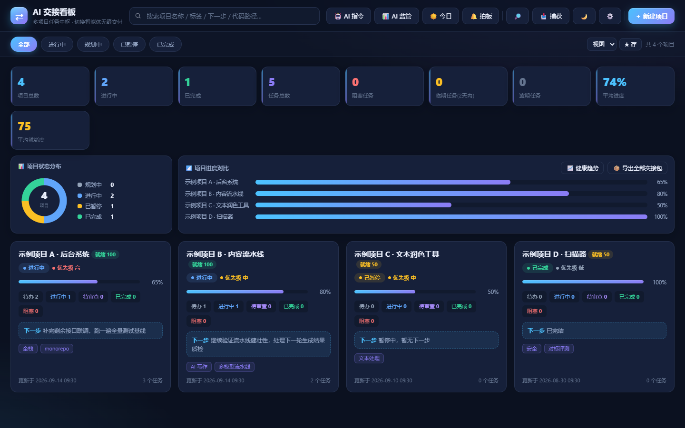
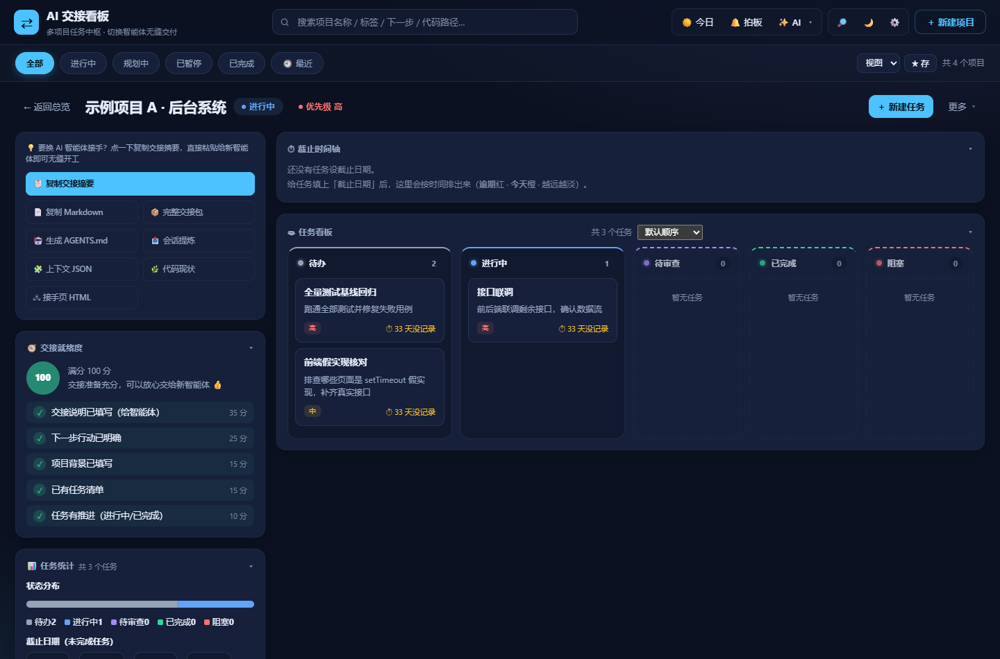

# AI Handoff Kanban (AI 交接看板)

[](https://github.com/fengxingxuerong/ai-handoff-kanban/actions/workflows/ci.yml)
[](https://github.com/fengxingxuerong/ai-handoff-kanban/releases)
[](LICENSE)

Language: [中文](README.md) | **English**

A local-first, multi-project task board for people who **switch AI coding agents all day**
(Claude Code, Codex, Cursor, Gemini CLI, …). Every project carries its handoff notes, next
actions, acceptance criteria and memories; one click produces the handoff pack and the
`AGENTS.md` entry files, and a bundled **23-tool MCP server** lets any agent read and write
the board directly — so the next agent starts with zero context cost.

This is **not** an agent-orchestration platform. It is the handoff desk between you and the
agents you keep swapping: the human stays in the loop, the board stays on your machine.





## Why this exists

Context dies on every agent switch. Copy-pasting "what we were doing" into a new session
loses decisions, traps and conventions — and nothing tells you whether the board still
matches what the code actually does. This app makes the handoff itself a first-class,
measured artifact:

- **Handoff-centric fields**: background, next action, handoff notes, acceptance criteria
  (`- [ ]` checklists rendered across every output), task dependencies with cycle detection.
- **Memories that behave like knowledge**: typed entries with expiry dates, weighted recall
  (decisions/pitfalls outrank background facts), size estimates for context budgeting.
- **Honesty features**: a repo radar flags "the board says done but the code moved on"
  (and the reverse); every readiness claim lists the evidence it is based on.

## Highlights

- **Multi-project overview** with KPI cards, due-date heatmap, a triage inbox
  (overdue / awaiting review / blocked) and a Ctrl+K command palette.
- **One-click handoff artifacts**: chat-ready summary, full handoff pack (Markdown),
  a **self-contained takeover HTML page** (inline SVG dependency graph, no CDN, works offline),
  and `AGENTS.md` **projected to 9 entry files** — `CLAUDE.md` bridge, `.cursor/rules`,
  `.github/copilot-instructions.md`, `GEMINI.md`, `.clinerules`, `CONVENTIONS.md`,
  `.windsurfrules`, `.claude/skills/ai-kanban/SKILL.md`.
- **MCP server** (stdio): 23 tools + resources + prompts. Agents list projects, pull the
  takeover context (with `sections` / `since` incremental slices), read/write tasks and
  memories, and generate handoff artifacts. Read-only mode; the one destructive tool
  (`kanban_delete_project`) requires `confirm=true`; restore is deliberately not a tool.
  **Non-Chinese callers are first-class**: `status`, `priority` and memory `type` accept English
  aliases (`todo`, `in_progress`, `done`, `high`, `pitfall`, …) and are normalized to the canonical
  values before anything is stored; tool titles are bilingual (`中文 · English`) so the permission
  dialog reads sensibly to a human.
- **LLM self-supervision**: multi-endpoint gateway with key rotation and failover; scheduled
  analyses produce health reports, trends and suggested task actions — always behind a
  human confirmation gate.
- **Windows-native packaging**: two PyInstaller single-file executables — the GUI app
  (PyWebView) and a console `MCP` server (so agents work even without a Python venv).

## Quality gates (the unusual part)

Every release is decided by **one command** (`scripts/ci_local.py --with-exe`), which runs in
CI on every push (windows-latest) and again per tag before a GitHub Release is cut:

- **826 tests** collected; branch coverage 93.7% with an explicit `--cov-fail-under=90`
  (numbers in the docs are pinned by a doc-consistency test, so they can't silently rot).
- **85 mutation probes**: semantic mutations are injected into the source and must be caught
  by the suite — "changed and still green = blind spot = fail". Coverage says a line ran;
  this says a line's mistakes would be noticed.
- **Real-browser E2E** (system Edge/Chrome), **real MCP stdio frozen smoke** against the
  packaged exe (stdout must stay pure JSON-RPC, Chinese must survive both directions),
  and a **delivery drill** that simulates a fresh agent taking over end to end.
- Tag releases are refused unless the tag matches `app/version.py` — the single source of
  version truth (UI, `/api/health`, MCP `serverInfo` and the exe's PE resource all read it).

## Install

Download the two executables from
[Releases](https://github.com/fengxingxuerong/ai-handoff-kanban/releases):
`AI交接看板.exe` (GUI) and `AI交接看板-MCP.exe` (MCP console server). No Python needed.

To build from source: Python 3.13 + `build.bat` (creates a venv, installs the locked
dependencies, stamps the build, packs both exes).

## Point your agent at the board

```json
{
  "mcpServers": {
    "ai-kanban": {
      "command": "D:\\path\\to\\AI交接看板-MCP.exe"
    }
  }
}
```

The MCP server talks to the local board over stdio and never exposes anything beyond
`127.0.0.1`. See [docs/MCP-契约.md](docs/MCP-契约.md) for the full tool contract (Chinese).

On Linux/macOS (or for directory health checks), run the same console server in Docker:
`docker run -i --rm -v ~/.ai-kanban:/data <image built from Dockerfile>` — the board data
stays on the host via the mounted volume.

## Data & privacy

- All data lives in `%USERPROFILE%\.ai-kanban` (plain JSON files + backups). Nothing is
  uploaded anywhere; there is no account and no telemetry.
- Anything that could leave the machine (exported links, handoff pages) is hard-restricted
  to `127.0.0.1`; sharing outward requires an explicit redact-before-export step.
- Session ingestion only reads directories you explicitly configured as session sources.

## Documentation (Chinese)

- [README.md](README.md) — full feature tour and usage
- [docs/数据层约定.md](docs/数据层约定.md) — data-layer conventions
- [docs/MCP-契约.md](docs/MCP-契约.md) — MCP tool contract
- [docs/测试约定.md](docs/测试约定.md) — testing conventions
- [docs/进度与版本档案.md](docs/进度与版本档案.md) — per-round progress & verified baselines

## License

[MIT](LICENSE)
