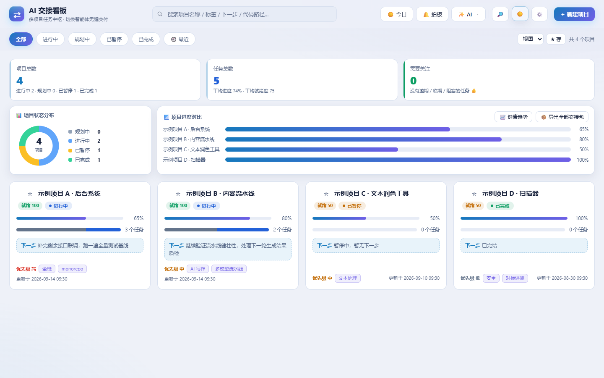
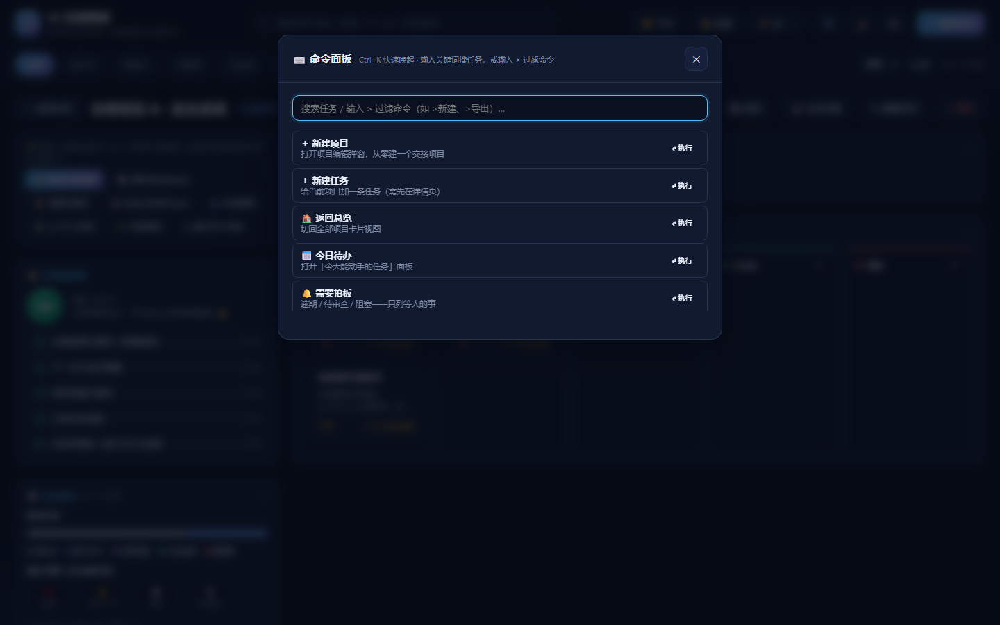

# AI 交接看板

[](https://github.com/fengxingxuerong/ai-handoff-kanban/actions/workflows/ci.yml)
[](https://github.com/fengxingxuerong/ai-handoff-kanban/releases)
[](LICENSE)

语言：[中文](README.md) | [English](README.en.md)

多项目任务中枢桌面应用，专为「切换 AI 智能体做项目」设计：每个项目带交接说明与下一步行动，一键复制交接摘要，新智能体接手零成本。内置 **AI 自我监管**（多 LLM 端点自动分析健康度、生成建议、维护任务），并有 **可视化仪表盘** 与 **一键完整交接包** 提升交付效率。

> 当前版本 **v1.9.6**。`app/version.py` 是唯一事实来源 —— 界面版本条、`/api/health`、
> MCP `serverInfo`、exe 的 PE 版本资源都读它，`tests/test_docs.py` 会核对本文档与 AGENTS.md 写的是同一个数。

## 界面

Windows 桌面应用（PyWebView 原生窗口，单文件 exe），内置深浅两套主题：


| 浅色主题 | ⌨️ 命令面板（Ctrl+K） |
| --- | --- |
|  |  |

## 功能

- **多项目总览**：卡片网格展示所有项目，状态徽章 / 进度条 / 任务统计 / 下一步行动一目了然，支持搜索与状态筛选
- **可视化仪表盘**：统计卡片（项目/任务/阻塞/平均进度/平均就绪度）+ 项目状态分布环形图 + 进度对比条形图（纯 SVG，零依赖离线可用）
- **就绪度徽章**：每项目自动计算「交接就绪度」（交接说明/下一步/背景/任务/推进情况五项打分），卡片直接显示，缺什么一目了然
- **单项目详情**：项目背景、交接说明（Markdown 渲染预览）、下一步行动 + 五列任务看板；并附「交接就绪度检查清单」逐项提示缺口
- **任务截止日期**：任务可设截止日期，任务卡显示逾期/临期徽章，仪表盘统计临期(2天内)与逾期数量
- **看板拖拽**：五列任务看板直接拖拽改状态，不用开弹窗
- **列内排序**：任务多了不用翻 —— 一键按 优先级 / 截止日期 / 最近更新 重排（只影响显示，不动数据顺序；选择会记住）
- **☀️ 今日待办**：跨项目把「依赖已满足、现在就能动手」的任务聚成一屏，按优先级/截止排序，点一条直接跳到它的项目（不用逐个项目点开翻）
- **首屏不空转**：一个项目都没有时给三步引导（新建 → 写清交接说明与下一步 → 复制给智能体）并直接开新建弹窗；搜索框有内容才露出清空按钮（点一下回到全量列表，焦点留在搜索框；按 Esc 同样退出搜索）；总览「需要关注」卡片可点，直达逾期/待审查/阻塞的待拍板列表；筛选/搜索为空时给「查看全部」一键复位；零任务项目显示单个空态和新建入口，不再摊开五个空列
- **窄屏先看任务**：980px 以下任务板提到侧栏之前，390px 无横向溢出；宽屏滚动左侧长面板时任务板停在视野里；触屏设备项目卡操作常显；窄窗口顶栏自动压缩
- **数据导入导出**：全量数据一键导出 JSON / 导入恢复（导入前自动留快照），换电脑迁移无缝
- **交接导出**：复制交接摘要（聊天直接粘给新 AI）、复制 Markdown、**📦 完整交接包**（单项目或全部项目合并导出，可编辑、可复制、可保存 .md 到桌面；保存到已存在的路径默认拒绝，需勾「覆盖已有文件」）、**🖧 接手页 HTML**（单文件网页：目录 + 依赖图 + 一键复制，离线双击可用）
- **交接包尺寸预算**：包弹窗实时显示「约 N 行 / X KB」，偏长/过载会给颜色与提示；MCP 返回的交接包尾部同样带一行尺寸。接手方是模型，上下文窗口才是稀缺资源 —— 包不是越长越负责
- **实时直链**：交接包与 MCP 都会给出 `http://127.0.0.1:18320/api/context/<id>`，同机智能体一条 curl 取**活数据**，不用吃过期快照（只给 127.0.0.1，数据不出本机）
- **健康分趋势图**：历次 AI 监管报告的健康分画成折线趋势，看项目健康变化
- **AI 监管报告**：一键分析全部项目 → 健康分 / 风险点 / 建议，逐条确认后可写入项目「下一步行动」
- **AI 自然语言维护**：说人话就能操作看板，如「给墨匠加一个任务：完成部署文档，优先级高」，AI 解析成操作、你确认后执行
- **AI 交接文档生成**：详情页一键让 AI 撰写/润色交接说明，预览确认后应用到项目
- **AGENTS.md 一键生成**：对接 Linux Foundation 行业标准，AI 按规范为项目生成 AGENTS.md（命令/约定/坑/进度），可直接保存到项目仓库根目录，任何编码代理打开仓库自动加载
- **会话提炼**：把与其他 AI 工具（cline/豆包等）的对话粘进来，AI 自动提炼成新任务、下一步行动与交接说明补充，一键应用
- **数据一键备份**：本地快照备份项目与配置（保留最近 10 份），可在 AI 设置里随时备份查看
- **数据自愈与恢复**：每次保存自动留一份「最近正常状态」，文件被同步盘/杀软弄坏时自动救回；
  也能从任意历史快照一键回滚（恢复前自动留安全副本）
- **定时自动监管**：设置每天/每周自动生成监管报告，存入历史报告随时回看
- **多端点容灾**：SenseNova（多 Key 轮询）/ AMD / NVIDIA 任一失败自动切换；kimi 系模型 temperature 自动适配
- **会话捕获**：自动探测本机 Claude Code / Cline 的会话文件，一键提炼成任务/下一步/记忆（支持 config 自定义会话源）
- **任务过程轨迹**：状态流转自动记录，可手动追加过程日志，交接包按任务带最近记录
- **项目记忆层**：决策/坑/约定结构化沉淀，会话提炼自动入库，AI 监管与交接包自动召回（对标 Mem0 的本地轻量版）
- **LLM 用量追踪**：每次调用的模型/Token/耗时/成败本地记账，设置页看按功能与按模型分布
- **逾期提醒**：启动与每次刷新检查临期/逾期任务，顶部横幅提示（每日一次不重复打扰）
- **MCP 只读模式**：分享/演示时一键禁止外部智能体写看板
- **机器可读接手包**：`GET /api/context/{pid}` 一次给出背景/交接说明/可执行任务/代码现状/就绪度；支持 `?sections=` 只取需要的小节、`?since=` 只列该时刻之后变化的条目（增量里 `start_here` 仍全量）；详情页「🧩 上下文 JSON」一键复制，MCP 工具 `kanban_context` 同步提供——智能体零粘贴接手
- **交接内容脱敏**：交接包 / 全项目包 / AGENTS.md 支持 `?redact=1`，自动掩码 API Key / 令牌 / 密码 / 邮箱（对标 handoff redact）
- **健康分趋势预警**：每份监管报告对比上一期，▼恶化 / ▲好转 / ◆持平 一眼看出哪个项目在滑坡
- **多智能体入口文件**：一次生成 AGENTS.md / CLAUDE.md / Cursor / Copilot / Gemini / Cline / Aider / Windsurf / .claude/skills（Agent Skills）九个入口
- **git 集成**：详情页「🌿 代码现状」看分支、最近提交、未提交改动；交接包自动带上这一节；
  AI 监管能看出"看板写着进行中、代码一周没动"
- **任务关联代码位置**：任务可填 `app/main.py:120` 这类落点，交接包与 AGENTS.md 会带上，
  换人/换工具接手不用再翻一遍找在哪改
- **任务验收标准**：每条任务可写「怎么算完成」的逐条清单（对标 Backlog.md 的 DoD），
  交接包 / 接手页 / MCP 全都带着走，验收与交接不再凭心情
- **🔔 待拍板**：跨项目汇总逾期 / 待审查 / 阻塞三类「等人的事」（对标 Multica 的 Inbox 哲学：
  依赖没满足的任务会自然流转，不算需要拍板）
- **记忆时效**：记忆可设有效期（YYYY-MM-DD），过期后不再进交接包 / AGENTS.md / AI 监管，
  界面划线标注、省略几条都会明说（对标 OKM 知识代谢）
- **过程记录折叠**：单任务过程日志超上限后，溢出的旧记录折叠成一条带计数的摘要而不是消失
  （对标 Beads 语义压缩）——体量有上限、脉络不丢
- **记忆召回与成本可见**：召回按类型加权（决策/坑/约定优先于背景事实，晚写的事实挤不掉早记的坑，
  对标 claude-mem 的 Awareness）；每条带尺寸估算（`≈N 字`，token 估算在悬浮提示里），
  记忆面板、`/api/memories`、MCP 列表三处同口径，MCP 截断时还会报未列出那批的合计成本，
  让消费方自己决定值不值得读进上下文
- **阻塞要带原因**：任务拖进「阻塞」时可顺手写一句「卡在哪、为什么」（可跳过）；原因上任务卡、
  进待拍板清单、写进交接包与接手包（「阻塞中的任务（为什么卡着）」小节），离开阻塞自动清空
  （历史留在过程记录里）—— 接手的人少问一轮
- **「验收后代码又变了」**：任务标「已完成」时记下时刻，仓库之后又有新提交就在详情页温和提醒
  复核（只提示，绝不自动改任何状态；未提交的脏文件不算数）
- **任务号一键复制**：任务弹窗里 📋 复制编号，贴进任何智能体对话作对齐凭据（12 位十六进制手抄不现实）

## 代码现状（git）

给项目填上「代码路径」后，详情页点「🌿 代码现状」就能看到：当前分支、HEAD、最近提交列表、
有多少未提交改动、距上次提交多少天。**刚提交完点开一定是新的**（这个接口不走缓存）。

顺手带来的两件事：

- **交接包自动带上「代码现状」一节**，新接手的 AI 打开就知道代码到哪了；读不到仓库时这一节自动省略。
- **AI 监管能看到代码现实**：它会拿到每个项目的 `days_since_commit` 与未提交文件数，
  于是能指出"看板写着进行中，代码却一周没动"这类不一致——只看看板数据是发现不了的。

安全边界：只读、只调用固定的几条 git 子命令、**从不经过 shell**（仓库路径里的特殊字符不会被当命令执行），
6 秒超时，读不到就降级成一句可行动的提示，绝不拖垮交接包导出。

## 数据在哪、坏了怎么办
数据默认在 `%USERPROFILE%\.ai-kanban\`：

| 文件 | 用途 |
| --- | --- |
| `projects.json` | 正本 |
| `projects.json.last-good` | 最近一次正常保存的副本（**每次保存自动刷新**） |
| `projects.json.bak` | 检测到损坏时的原文件留档（取证用，本身可能已不可读） |
| `projects.json.before-restore.bak` | 每次执行恢复前的安全副本 |
| `backups/backup_*/` | 手动快照，保留最近 10 份 |

- **正本解析失败时**：自动从 `last-good` 恢复并写回，界面提示一句；实在没得救才重置为空看板。
- **想主动回滚**：AI 设置 →「↩ 数据恢复」，会列出所有可用来源及其规模（几个项目 / 几个任务），
  点「恢复」即回滚，恢复前自动把当前数据另存一份。

## 使用方式

### 方式一：打包好的 exe（推荐日常使用）

**从 [Releases](https://github.com/fengxingxuerong/ai-handoff-kanban/releases) 下载两个单文件 exe**（`AI-Handoff-Kanban-v*.exe` 主程序 + `AI-Handoff-Kanban-MCP-v*.exe` MCP 服务，附 SHA-256 校验和），无需安装 Python；也可以用 `build.bat` 自己打包出 `dist\AI交接看板.exe`。首次启动自带示例项目，看板开箱即用；AI 功能需要你在 AI 设置里填自己的 Key（发行包不会内置任何 Key）。

> 运行环境：Windows 10/11 + Microsoft Edge WebView2 Runtime。Windows 11 通常自带；Windows 10 若启动空白，先安装 WebView2 Runtime。

> 如果双击后窗口空白或没反应，看 `%USERPROFILE%\.ai-kanban\startup.log`，里面记录了后端启动全过程；
> 打包后没有控制台，这个日志是唯一的排查入口。

### 让 AI 代理直接读写看板（MCP）

`app/mcp_server.py`（`scripts/mcp_server.py` 是它的兼容壳）是一个零依赖的 MCP 服务（stdio 传输、JSON-RPC 2.0），
Claude Code / Cursor / Cline / Windsurf / Codex 等可以直接列项目、读交接包、加任务、改进度，
不用再靠人把交接包粘来粘去。

**对非中文调用方友好**：状态 / 优先级 / 记忆类型都接受英文别名（`todo`、`in_progress`、`done`、`high`、`pitfall` …），归一到规范值后落盘；工具标题是「中文 · English」，权限弹窗里读得懂。

**三种注册方式，按你手上有什么选一种：**

```json
{
  "mcpServers": {
    "ai-kanban": {
      "command": "uvx",
      "args": ["--from", "git+https://github.com/fengxingxuerong/ai-handoff-kanban",
               "ai-handoff-kanban-mcp"]
    }
  }
}
```

> 需要 `uv`（`winget install astral-sh.uv`、或 `pipx install uv`）。这条**从仓库直接构建安装**，
> 写在这里因为它**今天就可用**；等包发到 PyPI 之后（见文末「发布」），
> `"args": ["--from", "ai-handoff-kanban", "ai-handoff-kanban-mcp"]` 这个短形式同样成立。
>
> `app/` 里没有 GUI 依赖，所以这一路在 Linux/macOS 上也能装（`pywebview`/`uvicorn`
> 只在 `desktop` extra 里）。数据仍在 `%USERPROFILE%\.ai-kanban`（或 `KANBAN_DATA_DIR`），
> 包只带服务本身 —— 换机器/换 agent 客户端都只改这一段配置。

**方式 B：用打包好的 `AI交接看板-MCP.exe`（Windows、不需要装 Python）**

下载/打包出来后，`dist\` 里有**两个** exe：

| 产物 | 干什么用 |
| --- | --- |
| `AI交接看板.exe` | 看图表的那个窗口程序（双击即用） |
| `AI交接看板-MCP.exe` | 给 AI 代理读写看板用的 MCP 服务（控制台程序，由代理客户端拉起，你不必双击它） |

各工具的 `mcpServers` 配置里指向第二个 exe 即可（路径换成你的实际位置）：

```json
{
  "mcpServers": {
    "ai-kanban": {
      "command": "D:\\tools\\AI交接看板-MCP.exe"
    }
  }
}
```

> 为什么单独一个 exe：MCP 走 **stdio** 传输，而 GUI 版本是 `-w` 打包的窗口程序，
> 在 Windows 上拿不到标准流。控制台子系统的这一份才是它的正确形态 —— 也因此它没有窗口，
> 双击它会看起来"什么都没发生"（它在等你从 stdin 发 JSON-RPC）。

**方式 C：从源码跑（开发/调试用，需要 .venv）**

```json
{
  "mcpServers": {
    "ai-kanban": {
      "command": "D:\\你的路径\\项目任务看板\\.venv\\Scripts\\python.exe",
      "args": ["D:\\你的路径\\项目任务看板\\scripts\\mcp_server.py"]
    }
  }
}
```

提供的工具（24 个）：

| 工具 | 用途 |
| --- | --- |
| `kanban_list_projects` | 所有项目概览（状态/进度/优先级/任务统计/交接就绪度/下一步） |
| `kanban_get_project` | 单个项目的完整上下文（背景、交接说明、下一步、全部任务） |
| `kanban_find_project` | 按名称模糊找项目 id |
| `kanban_create_project` / `kanban_update_project` | 建项目 / 改进度·下一步·交接说明 |
| `kanban_add_task` / `kanban_update_task` / `kanban_delete_task` | 任务增改删 |
| `kanban_next_task` | 下一个该做的任务（依赖已满足里挑优先级最高的） |
| `kanban_today` | 跨项目的「现在就能动手」清单，与界面 ☀️ 今日 同一份判定 |
| `kanban_search_tasks` | 跨项目搜任务（标题/描述/负责人），返回任务 id 可直接接着改 |
| `kanban_stats` | 全局统计与就绪度偏低的项目 |
| `kanban_handoff` | 导出完整交接包（Markdown） |
| `kanban_agents_md` | 生成 AGENTS.md 正文 |
| `kanban_log_progress` | 给任务追加一条过程记录（做了什么 / 改了什么决策 / 踩了什么坑） |
| `kanban_memory_add` | 往项目记忆层记一条决策 / 坑 / 约定，交接包与 AI 监管会自动召回 |
| `kanban_context` | **机器可读接手包**：背景/交接说明/代码现实/现在就能动手的任务/项目记忆/就绪度缺口，换取会话时先调这个；可用 `sections` 裁剪、`since` 只取增量 |
| `kanban_list_memories` | 查记忆层（按项目/类型/关键词过滤，每条带尺寸，默认脱敏） |
| `kanban_delete_memory` | 删掉一条记错/过时的记忆 |
| `kanban_export_all` | 导出全项目交接包（跨机迁移或整板存档） |
| `kanban_backup` | 拍一份数据快照（改动前的退路） |
| `kanban_list_backups` | 看有哪些快照可用 |
| `kanban_export_repo_snapshot` | 把看板快照写进它自己的仓库（`docs/kanban/`，人读 Markdown + 机读 board.json），默认脱敏、默认不覆盖手写文件 |
| `kanban_delete_project` | 删整个项目（**唯一**要 `confirm=true` 的工具：没有软删除，误删只能整份回滚） |

每个工具都带 `annotations`（`readOnlyHint` / `destructiveHint` / `idempotentHint`），客户端据此
对读操作免确认、对删除弹警告。打开 **MCP 只读模式**后，写工具与生成类工具会直接从
`tools/list` 里消失（调用侧的拒绝闸门同时保留，两道闸都在）。

工具返回里会带上本机直链（`http://127.0.0.1:18320/api/context/<id>`），
同机智能体可以直接 curl 取最新数据，不必依赖粘贴快照。

手动自测（不需要任何客户端）：

```bat
echo {"jsonrpc":"2.0","id":1,"method":"tools/list"} | .venv\Scripts\python.exe scripts\mcp_server.py
```

服务与桌面应用共用同一份数据文件，并带**跨进程文件锁**，两边同时写不会互相覆盖。
工具的字段白名单与应用一致（状态/优先级只能取固定值），非法值会被拒绝而不是写进看板。

### 方式二：源码运行

```bat
scripts\start_desktop.bat
```

（首次需先 `pip install -r requirements.txt`）

### 多智能体入口文件（一次全出）

详情页 →「AGENTS.md」→ 底部「一键写出各工具入口」：填上项目根目录，一次生成九个入口文件，
**`AGENTS.md` 是唯一事实来源，其余都是它的投影**（`CLAUDE.md` 只写 `@AGENTS.md` 做桥接、不复制正文，
避免九份内容各写各的慢慢漂移）：

```
AGENTS.md                            ← 正文（AI 生成；AI 不可用时自动用本地模板）
CLAUDE.md                            ← @AGENTS.md 桥接（Claude Code 不直接读 AGENTS.md）
.cursor/rules/project.mdc            ← 带 frontmatter（description / globs / alwaysApply）
.github/copilot-instructions.md
GEMINI.md
.clinerules/project.md
CONVENTIONS.md                       ← Aider
.windsurfrules
.claude/skills/ai-kanban/SKILL.md    ← Agent Skills 技能包（2026 起的第三个入口格式）
```

留空目录只预览不写盘；写入同样受系统目录拦截保护；前端预览过的内容再写盘时不会重复调用模型。
**仓库里已有的同名文件默认跳过不覆盖**（多半是你手写的），要覆盖得勾上「覆盖仓库里已有的入口文件」。

### 方式三：自行打包

```bat
build.bat
```

产物在 `dist\AI交接看板.exe`。已配好 `--hidden-import uvicorn / app.main` 与 `--add-data web;web`，可直接用。

**只装 MCP 那一个包**（`pyproject.toml` 在，所以 `pip` / `uv` 都能装；`app/` 里没有 GUI 依赖）：

```bat
.venv\Scripts\python.exe -m pip install .                      rem 装本仓库，装出 ai-handoff-kanban-mcp 命令
.venv\Scripts\python.exe -m pip wheel . --no-deps -w .tmp\wheels   rem 只建 wheel 不装（自测打包用）
```

**发布到 PyPI**（需要你自己的 token；**发布之前**，上面那句 `--from ai-handoff-kanban` 的短形式不成立）：

```bat
.venv\Scripts\python.exe -m pip install build twine
.venv\Scripts\python.exe -m build
.venv\Scripts\python.exe -m twine upload dist\ai_handoff_kanban-*.whl
```

> 版本号不用手改：`pyproject.toml` 的 `version` 是 `dynamic`，取自 `app/version.py` 的 `__version__`。

## 目录结构

```
项目任务看板/
├── app/main.py             # FastAPI 后端：路由编排 + 数据层临界区（核心逻辑拆在 app/ 下 30 个模块，见 AGENTS.md）
├── app/llm.py              # LLM 网关：多端点 + 多 Key 轮询 + 失败切换
├── web/index.html          # 前端页面骨架（零内联脚本；深色主题，含 AI 界面）
├── web/js-*.js             # 前端逻辑十个文件：core/overview/detail/render/reality/handoff/edit/ai/data/boot（无构建、无 CDN）
├── web/style.css           # 前端样式
├── tests/                  # pytest 套件：接口/并发/安全/数据/AI/前端契约/真实浏览器点击（含假 LLM 端点与系统浏览器，均不消耗配额）
├── scripts/desktop.py      # PyWebview 桌面壳（端口检测 + 后台自启服务）
├── scripts/start_desktop.bat  # 源码双击启动
├── scripts/init_ai_config.py  # 本机 AI 端点初始化（Key 从环境变量/私有文件读，脚本内不含 Key）
├── scripts/live_check.py   # 对着已跑起来的实例做只读体检（打接口，不写数据）
├── scripts/live_ui_check.py # 对着已跑起来的实例开真浏览器只读校验（证明界面没白屏）
├── scripts/make_stamp.py   # 打包前生成构建戳（版本条显示的"打包时间"）
├── scripts/scenario_test.py # 真实场景测试 32 例（真服务 + 真 MCP + 真实业务数据）
├── scripts/frozen_smoke.py # 冻结版自查：启动 dist 里的 exe 真打一遍接口
├── scripts/mcp_server.py   # MCP 服务（stdio）：让 AI 代理直接读写看板
├── scripts/bench.py        # 读写性能基准（先量再改）
├── build.bat               # 一键打包 exe
├── pytest.ini              # pytest 配置
├── .github/workflows/ci.yml # CI：push/PR 跑同一条本地门禁（ci_local --with-exe）并上传 exe
├── .gitignore              # 排除运行期数据、密钥与构建产物
└── requirements.txt / requirements-dev.txt
```

## 测试

```bat
rem 一次性装测试依赖
.venv\Scripts\python.exe -m pip install -r requirements-dev.txt

rem 全量测试（自动起隔离环境，跑完自动关；带覆盖率，低于 90% 直接失败）
rem 并行是写进 pytest.ini 的（-n auto），不用手动加：135s → 41s
.venv\Scripts\python.exe -m pytest -v

rem 只在需要真实模型配额时跑 AI 用例（其余 AI 用例走内置假端点，不消耗配额）
set KANBAN_LIVE=1
.venv\Scripts\python.exe -m pytest tests\test_ai.py -v

rem 只跑前端真实点击测试（复用系统 Edge/Chrome 打开真页面点，不下载 Chromium）
.venv\Scripts\python.exe -m pytest tests\test_frontend_e2e.py -v

rem 读写性能基准（先量再改）
.venv\Scripts\python.exe scripts\bench.py 1000

rem 真实场景测试：真服务 + 真 MCP + 真实业务数据跑 32 条用例，逐条打印目标/输入/预期/实际
rem （CI 里也有这一步：.github/workflows/ci.yml 跑的 ci_local 全门禁，改坏了会红）
.venv\Scripts\python.exe scripts\scenario_test.py --report 场景测试报告.md

rem 变异探针：往源码注入 109 处"真实可能发生的改动"，改了还全绿 = 盲区，判失败
rem （覆盖率只证明"这行跑过"，不证明"这行错了会被发现"——这一步量的是后者）
.venv\Scripts\python.exe scripts/mutation_probe.py
.venv\Scripts\python.exe scripts/mutation_probe.py --only due_soon_window   rem 只跑一条

rem 一条命令跑完所有门禁（自己起隔离实例，绝不碰 ~/.ai-kanban）
.venv\Scripts\python.exe scripts/ci_local.py            rem 含变异探针
.venv\Scripts\python.exe scripts/ci_local.py --quick    rem 只跑 pytest（最快的一轮反馈）
```

测试规模与覆盖率以 `AGENTS.md` 的「验证基线」为唯一数字来源（README 里再写一份必然漂）；
取数命令：`python -m pytest -o addopts="" --collect-only`。
其中 5 项默认跳过（需 `KANBAN_LIVE=1` 才跑真实模型），覆盖率门槛 90%。

慢的用例都是「真东西」：真 uvicorn 子进程、真 MCP stdio、真浏览器。它们彼此独立，
所以用 `-n auto` 并行把这些墙钟时间叠起来（实测 135s → 41s）。串行跑只是为了定位问题。

| 文件 | 覆盖内容 |
| --- | --- |
| `test_api.py` | 基础 CRUD、导出、统计、示例数据脱敏 |
| `test_security.py` | 字段白名单、特殊字符名称、Host/Origin 防护、保存路径限制、Token 鉴权 |
| `test_concurrency.py` | 并发写入不丢更新（20/30 并发落盘）、字段与任务混合写入 |
| `test_ai_endpoints.py` | 全部 AI 路径（分析/提炼/指令/交接/AGENTS.md/建议落地/趋势），含乱码输出、端点全挂、本地兜底 |
| `test_llm_gateway.py` | 网关容灾：多 Key 轮询、429/5xx 切端点、全失败聚合报错、JSON 容错、掩码、配置兼容 |
| `test_ai_config.py` | 配置读写与掩码往返（改端点名不丢 Key）、调度周期键 |
| `test_misc.py` | 备份、导出落盘回退、脏数据规范化、损坏文件恢复、404 边界 |
| `test_frontend.py` | 前端契约：内联事件必须为零、每个 `data-act` 必须有实现、搜索防抖 |
| `test_frontend_e2e.py` | **真实浏览器点击**（Playwright + 系统 Edge/Chrome），16 项：渲染、建项目、加任务、搜索跳转、删除确认、主题、空看板、特殊字符、导出下载、导入覆盖、拖拽改状态，以及 AI 交互（报告渲染、指令的人工闸门、会话提炼落地、测连接）；任何 JS 报错直接判失败 |
| `test_coverage_gaps.py` | 补齐"逻辑真但一直没测到"的分支：健康趋势对比（down/up/flat/new）、调度触发与防重、LLM 网关错误分类与 temperature 重试、导出路径放行 |
| `test_version.py` | 版本与构建时间：源码态取最新 mtime、打包态读构建戳、生成物不参与比较、缺戳如实报「未知」 |
| `test_data_io.py` | 全量数据导出/导入：导出不含密钥、导入是覆盖语义且先做快照、脏数据规范化、坏文件拒绝、往返一致性 |
| `test_v110_features.py` | 1.1.0 六个新面：用量聚合与坏行跳过、记忆层 CRUD/过滤/去重/类型归一、会话扫描与三种格式解析、会话入库链路、轨迹在 context 与交接包里可见 |
| `test_storage_limits.py` | 存储不无限增长：usage 滚动裁剪、并发追加不错行、journal 条数与长度上限、脏轨迹规范化、会话读取限源、只读模式作用域 |

AI 用例默认打本地假端点（`tests/llm_stub.py`，OpenAI 兼容），**不消耗任何模型配额**；
只有 `KANBAN_LIVE=1` 的 `test_ai.py` 会走真实模型。

**应用正带着你的真实数据跑着、只想确认它现在是健康的**（只读，不写任何数据）：

```bat
.venv\Scripts\python.exe scripts\live_check.py http://127.0.0.1:18320 --mcp
.venv\Scripts\python.exe scripts\live_ui_check.py http://127.0.0.1:18320
```

**每次打包后跑一次冻结版自查**（会短暂弹出应用窗口，脚本自己关掉它）：

```bat
.venv\Scripts\python.exe scripts\frozen_smoke.py
```

它验证的是"exe 真能服务"：后端 HTTP 就绪、首页与内嵌前端完整、项目增删读闭环、
跨站请求被拒。打包后没有控制台，后端起不来是静默的，这一步能兜住。
如果失败，脚本会自动打印应用的启动日志（`%USERPROFILE%\.ai-kanban\startup.log`）。

## 数据与配置说明

- 项目数据：`%USERPROFILE%\.ai-kanban\projects.json`（可用环境变量 `KANBAN_DATA_DIR` 改目录）
- AI 配置：`%USERPROFILE%\.ai-kanban\config.json` —— **内含 API Key，属敏感文件，请勿分享或提交到公开仓库**；应用界面中 Key 已脱敏显示
- 监管报告：`%USERPROFILE%\.ai-kanban\reports\*.json`（历史报告）
- 端口：默认 `18320`，可用环境变量 `KANBAN_PORT` 覆盖；已占用时自动连接已有实例
- 首次启动自带 4 个示例项目，可直接修改或删除

## 安全说明（本地服务）

服务只监听 `127.0.0.1`，并做了以下限制：

- **Host / Origin 校验**：拒绝非本机 Host 与跨站 Origin 的请求，防止恶意网页跨站打洞与 DNS rebinding 读写看板
- **写接口字段白名单**：状态/优先级只接受固定取值，越界返回 422（避免异常值污染前端渲染）
- **导出保存路径限制**：只允许 `.md` / `.txt` / `.markdown`，且拒绝写入系统目录（Windows/Program Files/AppData 等）
- **可选访问令牌**：设置环境变量 `KANBAN_TOKEN=xxx` 后，所有写请求必须带 `X-Kanban-Token: xxx`。
  服务端会把 token 注入首页 meta，桌面 UI 自动带上；用脚本/curl 操作时需要自行带上该头。
- **不做用户鉴权**：单机单用户场景下任何本机进程都与当前用户同权限，因此本服务不防御本机进程，
  只防御来自浏览器/网络的跨站访问
- **AI 数据边界**：只有你主动触发 AI 监管 / AI 指令 / 交接说明生成时，项目摘要才会发往你在设置里配置的 LLM 端点；
  凭据会脱敏，但项目正文会离开本机。不配置 Key 时看板完全本地可用。
- **备份包含配置**：手动备份与导入前备份会复制 `config.json`（含明文 API Key），换机或共享备份目录时请自行加密/清理。

### 密钥管理

`scripts/init_ai_config.py` **不再内置任何 Key**。初始化时用环境变量或本机私有文件：

```bat
rem 方式一：环境变量（多个 Key 用逗号分隔）
set KANBAN_KEY_SENSENOVA=sk-aaa,sk-bbb
.venv\Scripts\python.exe scripts\init_ai_config.py
```

方式二：把 Key 写进 `%USERPROFILE%\.ai-kanban\keys.local.json`（不在项目目录内，不会被一起分发）：

```json
{ "SenseNova": ["sk-aaa"], "OpenRouter": ["sk-xxx"] }
```

端点名需与 `app/llm.py` 中 `DEFAULT_ENDPOINTS` 的 `name` 一致，未知端点会被跳过。

